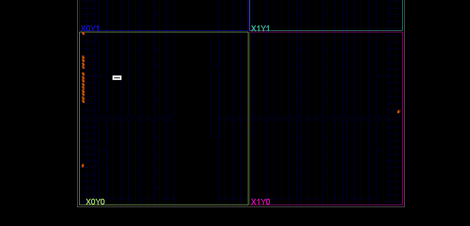
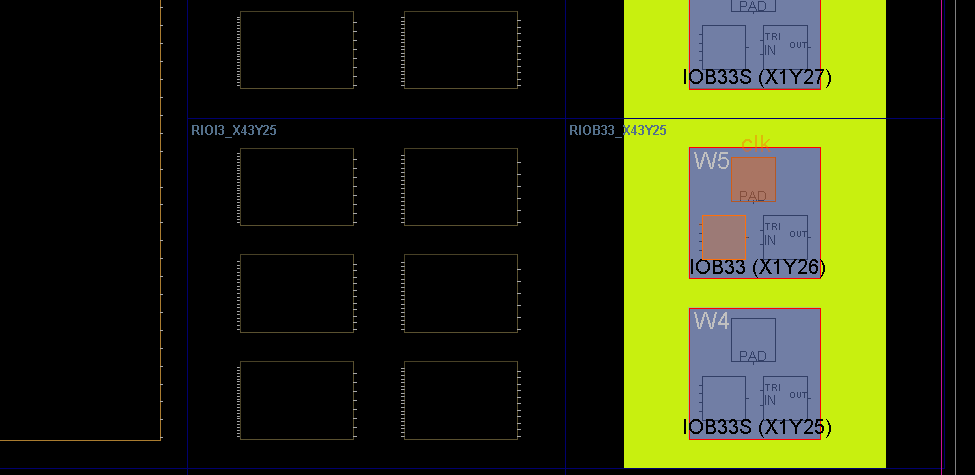
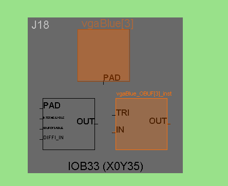
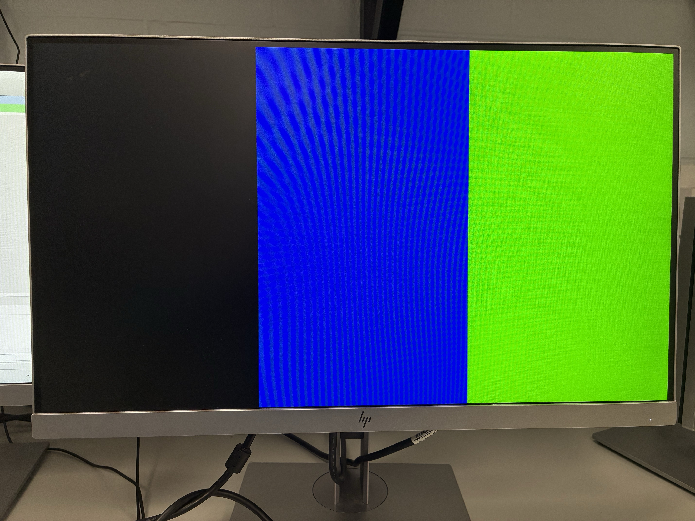

AIM: Run provided example code and modify it to show understanding

## **Template VGA Design**
### **Project Set-Up**
1. Create new project
2. Add provided files
3. Select board model
4. Set up clock
5. Generate bitstream
6. Program device 

### **Template Code**
- `Basys3_Master.xdc` – FPGA pin assignment and timing constraints.
- `Testbench.v` – Provides test inputs for simulating the design.
- `VGAColourStripes.v` – Generates RGB pixel colours and defines the visual pattern.
- `VGASync.v` – Generates VGA synchronisation signals and pixel coordinates.
- `VGATop.v` – Top-level module connecting the clock, VGA timing and colour generation modules.

## **My VGA Design Edit**
I attempt a first change to the code with the examples shown by lecturer which include reducing the stripes to 3 and setting the colour.

### **Simulation**
- Set the parameter to a smaller unit to reduce simulation time and make waveforms easier to observe

### **Synthesis**

Describe the synthesis and implementation processes. Consider including 1/2 useful screenshot(s). Guideline: 1/2 short paragraphs.

### **Demonstration**

first edit 
Perhaps add a picture of your demo. Guideline: 1/2 sentences.

### **Additional**
In a monitor, each row has a wire to activate the row, and each column have 3 datalines for RGB respectively.
