AIM: Run provided example code and modify it to show understanding

## **Template VGA Design**
### **Project Set-Up**
1. Create new project
2. Add provided files
3. Select board model
4. Set up clock
5. Generate bitstream
6. Program device 

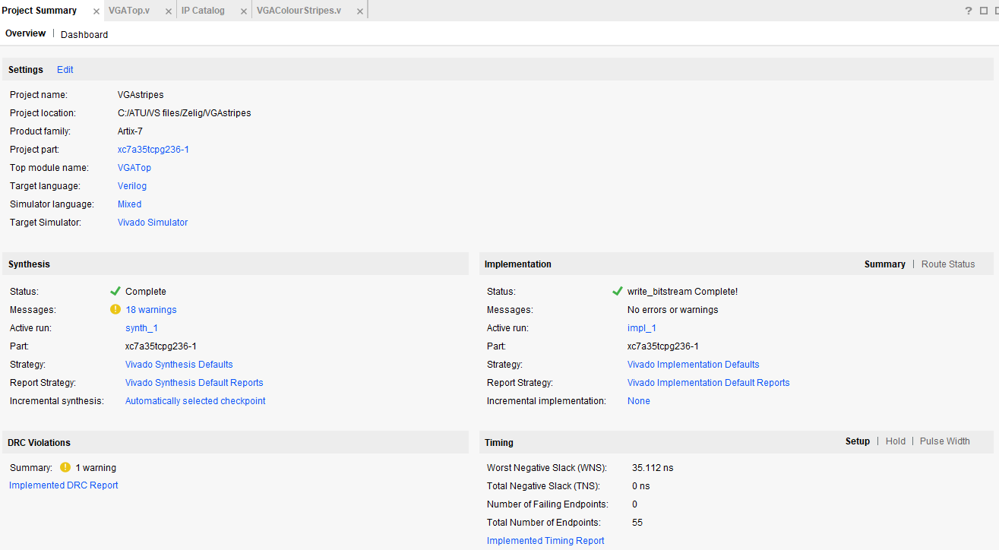### **Template Code**
- `Basys3_Master.xdc` – FPGA pin assignment and timing constraints.
- `Testbench.v` – Provides test inputs for simulating the design.
- `VGAColourStripes.v` – Generates RGB pixel colours and defines the visual pattern.
- `VGASync.v` – Generates VGA synchronisation signals and pixel coordinates.
- `VGATop.v` – Top-level module connecting the clock, VGA timing and colour generation modules.
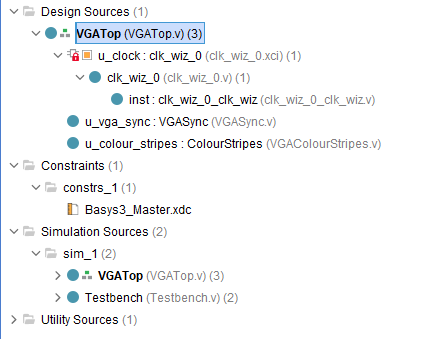

## **My VGA Design Edit**
- I attempt a first change to the code with the examples shown by lecturer which include reducing the stripes to 3 and setting the colour.
- I changed the col variable with the row variable to produce horizontal stripe with different colours. 
- I divide row and col by a width and XOR them and AND with 1 so the least significant bit is 0 if both divided row and col are even else 1 [if (((row / 40) ^ (col / 40)) & 1'b1)]
- Added a clock counter and an offset to flip the checker 
- Changed the formula of the offset for a smooth diagonal movement

- Implemented a new smiley face project, lot's of error in code but uploaded anyway because it is amusing:
    - did not end if statement
    - did not handle signed negative value
- fixed the error and got a working smiley face 

Code 
```verilog
reg [5:0] offset;
reg [23:0] speed_counter;

always @(posedge clk or posedge rst) begin
    if (rst) begin
        offset <= 6'd0;
        speed_counter <= 24'd0;
    end
    else begin
        if (speed_counter >= 24'd1_000_000) begin
            speed_counter <= 24'd0;

            if (offset == 6'd39)
                offset <= 6'd0;
            else
                offset <= offset + 1'b1;
        end
        else begin
            speed_counter <= speed_counter + 1'b1;
        end
    end
end


 Next state & output logic state  machine 
always@* begin
    if ((((row + offset) / 40) ^ ((col + offset) / 40)) & 1'b1) begin      
      red_next   <= 4'b0101;
      green_next <= 4'b1010;
      blue_next  <= 4'b0000;
   end
   else begin
      red_next   <= 4'b1111;
      green_next <= 4'b0101;
      blue_next  <= 4'b1010;
   end
end
```

Code for smiley face 
```verilog

integer dx, dy;
integer eye_dx, eye_dy;
integer distance_squared;

always @* begin

    // Default background: black
    red_next   = 4'b0000;
    green_next = 4'b0000;
    blue_next  = 4'b0000;

    // Calculate distance from centre of face
    dx = $signed({1'b0, col}) - 320;
    dy = $signed({1'b0, row}) - 240;

    distance_squared = dx * dx + dy * dy;

    // Yellow circular face (radius 100)
    if (distance_squared <= 10000) begin

        red_next   = 4'b1111;
        green_next = 4'b1111;
        blue_next  = 4'b0000;

        // Left eye (centre: 285, 210)
        eye_dx = $signed({1'b0, col}) - 285;
        eye_dy = $signed({1'b0, row}) - 210;

        if ((eye_dx * eye_dx + eye_dy * eye_dy) <= 36) begin
            red_next   = 4'b0000;
            green_next = 4'b0000;
            blue_next  = 4'b0000;
        end

        // Right eye (centre: 355, 210)
        eye_dx = $signed({1'b0, col}) - 355;
        eye_dy = $signed({1'b0, row}) - 210;

        if ((eye_dx * eye_dx + eye_dy * eye_dy) <= 36) begin
            red_next   = 4'b0000;
            green_next = 4'b0000;
            blue_next  = 4'b0000;
        end

        // Smiling mouth (lower half of annulus)
        if ((distance_squared >= 4200) &&
            (distance_squared <= 4900) &&
            (row >= 240)) begin

            red_next   = 4'b0000;
            green_next = 4'b0000;
            blue_next  = 4'b0000;
        end

    end
end
```

### **Simulation**
- Set the parameter to a smaller unit to reduce simulation time and make waveforms easier to observe
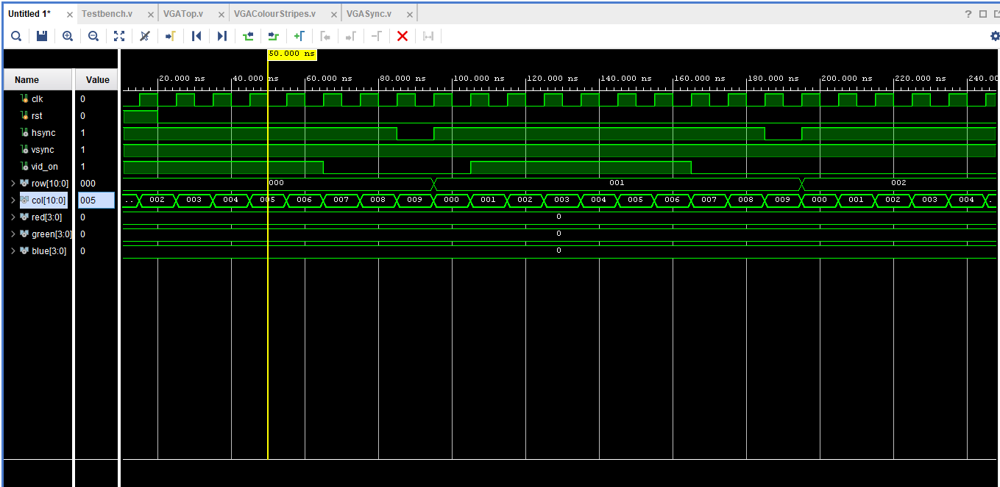


### **RTL Analysis**

RTL Analysis (Register Transfer Level Analysis) is a stage in FPGA design where Vivado examines your Verilog code and translates it into a hardware representation.
Below shows the schematic at the RTL:
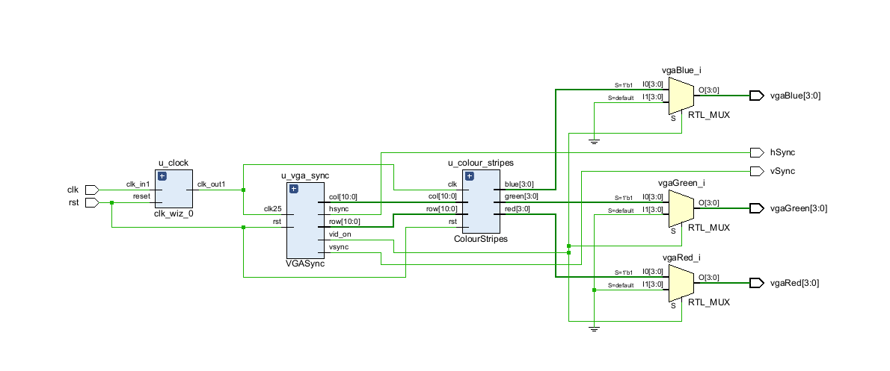
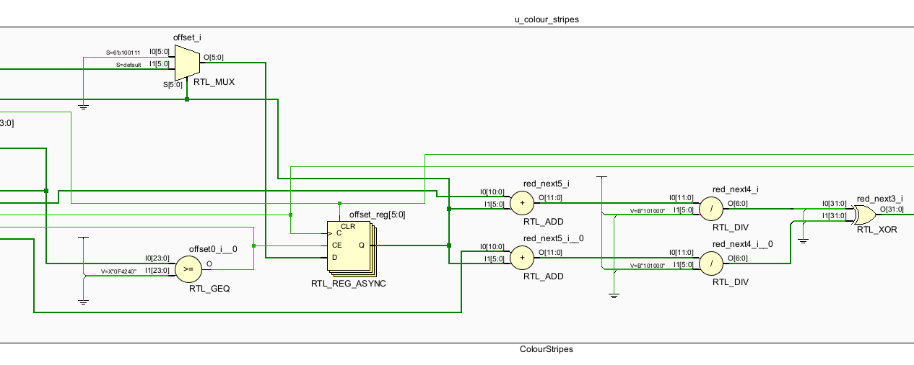
Closer up we can see the individual gates implementing the logic that is programmed in code for example ADD, DIVIDE, XOR, etc...

### **Synthesis and Implementation Analysis**
In the implementation schematics, each bit in hcount have a look up table (LUT)
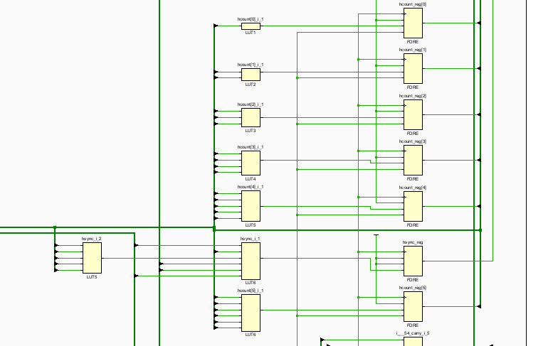
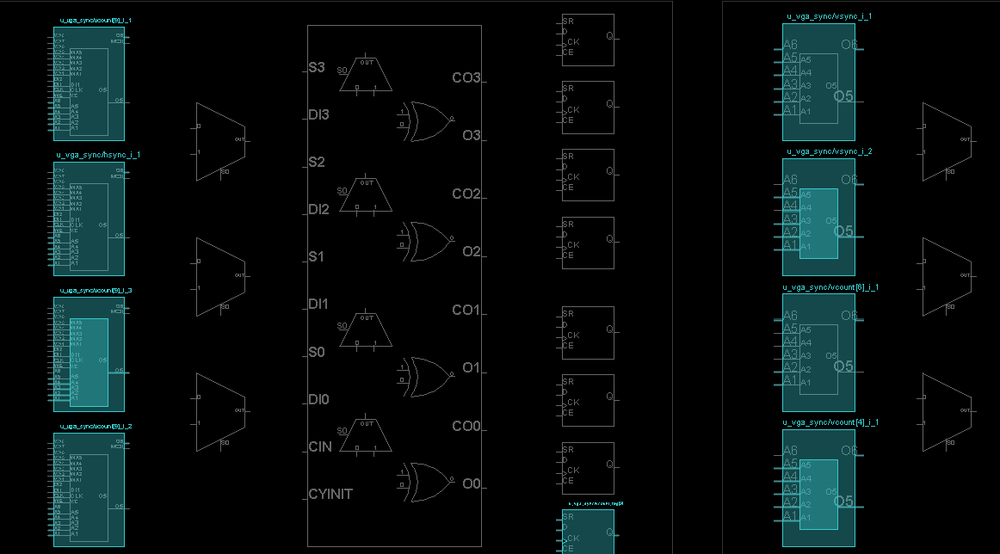

1. Synthesis schematic
Synthesis converts your Verilog RTL into FPGA logic components, such as:
- LUTs (Look-Up Tables)
- Flip-flops
- Multiplexers
- Carry chains
- Other FPGA resources
It determines what hardware needs to exist.
2. Implementation schematic
Implementation takes the synthesised netlist and performs:
- Optimisation: Further optimises the circuit.
- Placement: Assigns logic components to physical locations on the FPGA.
- Routing: Connects the components using physical FPGA routing resources.
It determines where the hardware goes and how the components connect physically.


### **Demonstration**
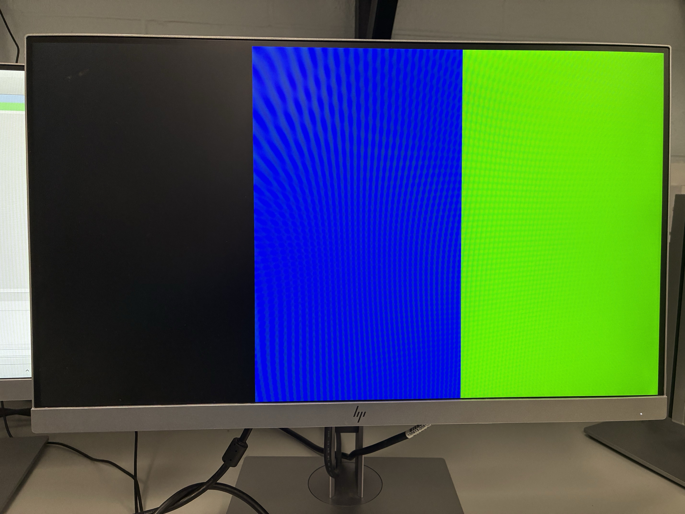
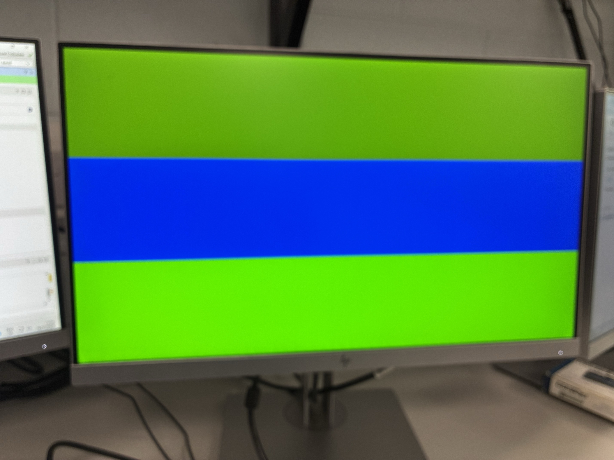
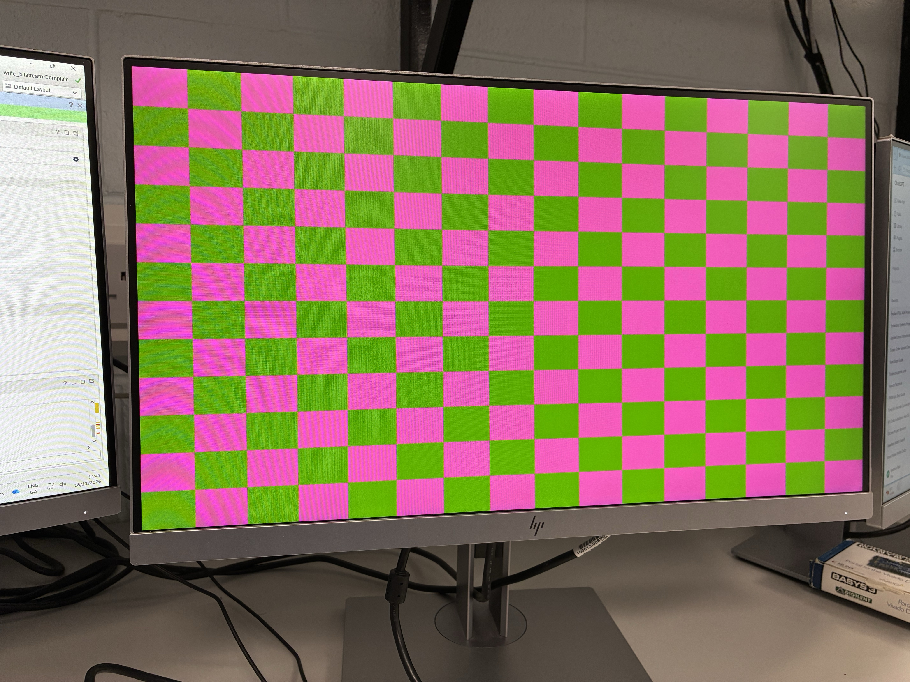

<video controls width="100%">
  <source src="./docs/assets/videos/fourth-implementation.mp4" type="video/mp4">
  Your browser does not support HTML video.
</video>

<video controls width="100%">
  <source src="./docs/assets/videos/fifth-implementation.mp4" type="video/mp4">
  Your browser does not support HTML video.
</video>

<video controls width="100%">
  <source src="./docs/assets/videos/sixth-implementation.mp4" type="video/mp4">
  Your browser does not support HTML video.
</video>

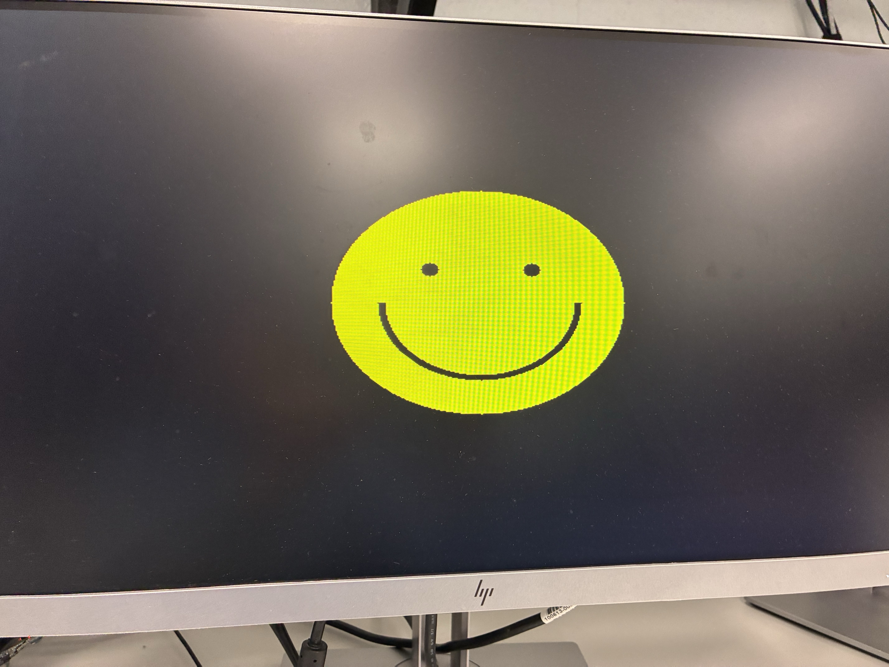


### **Additional**
In a monitor, each row has a wire to activate the row, and each column have 3 datalines for RGB respectively.
