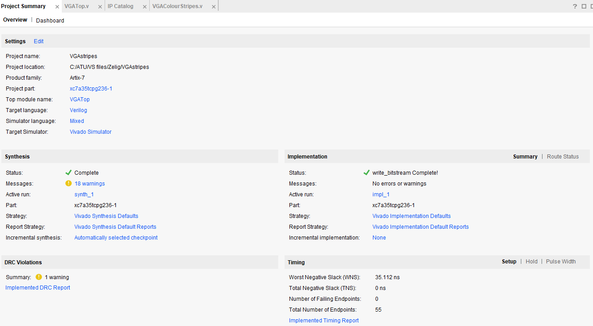
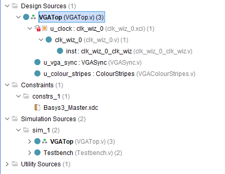
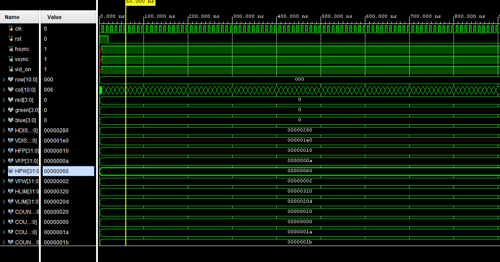

AIM: Run provided example code and modify it to show understanding

## **Template VGA Design**
### **Project Set-Up**
1. Create new project
2. Add provided files
3. Select board model
4. Set up clock
5. Generate bitstream
6. Program device 

### **Template Code**
- `Basys3_Master.xdc` – FPGA pin assignment and timing constraints.
- `Testbench.v` – Provides test inputs for simulating the design.
- `VGAColourStripes.v` – Generates RGB pixel colours and defines the visual pattern.
- `VGASync.v` – Generates VGA synchronisation signals and pixel coordinates.
- `VGATop.v` – Top-level module connecting the clock, VGA timing and colour generation modules.

### **Simulation**
- Set the parameter to a smaller unit to reduce simulation time and make waveforms easier to observe

### **Synthesis**
Describe the synthesis and implementation processes. Consider including 1/2 useful screenshot(s). Guideline: 1/2 short paragraphs.
### **Demonstration**
Perhaps add a picture of your demo. Guideline: 1/2 sentences.

## **My VGA Design Edit**
Introduce your own design idea. Consider how complex/achievabble this might be or otherwise. Reference any research you do online (use hyperlinks).
### **Code Adaptation**
Briefly show how you changed the template code to display a different image. Demonstrate your understanding. Guideline: 1-2 short paragraphs.
### **Simulation**
Show how you simulated your own design. Are there any things to note? Demonstrate your understanding. Add a screenshot. Guideline: 1-2 short paragraphs.
### **Synthesis**
Describe the synthesis & implementation outputs for your design, are there any differences to that of the original design? Guideline 1-2 short paragraphs.
### **Demonstration**
If you get your own design working on the Basys3 board, take a picture! Guideline: 1-2 sentences.

## **More Markdown Basics**
This is a paragraph. Add an empty line to start a new paragraph.

Font can be emphasised as *Italic* or **Bold**.

Code can be highlighted by using `backticks`.

Hyperlinks look like this: [GitHub Help](https://help.github.com/).

A bullet list can be rendered as follows:
- vectors
- algorithms
- iterators

Images can be added by uploading them to the repository in a /docs/assets/images folder, and then rendering using HTML via githubusercontent.com as shown in the example below.

